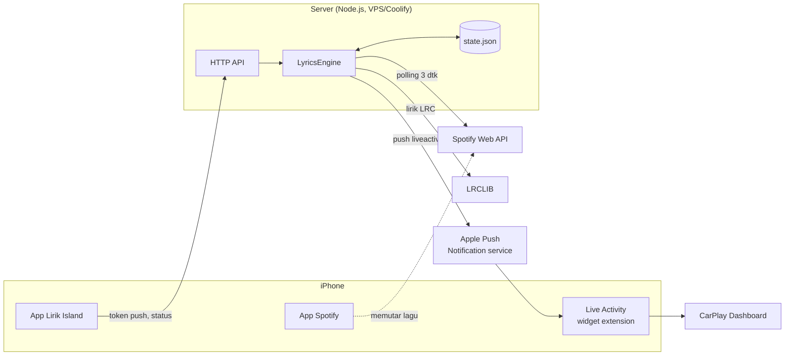
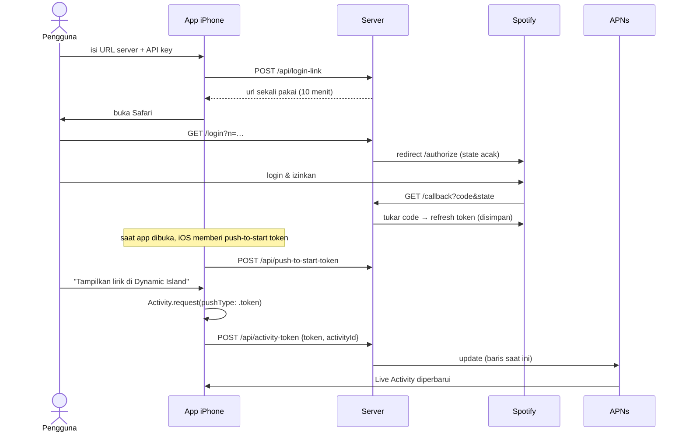
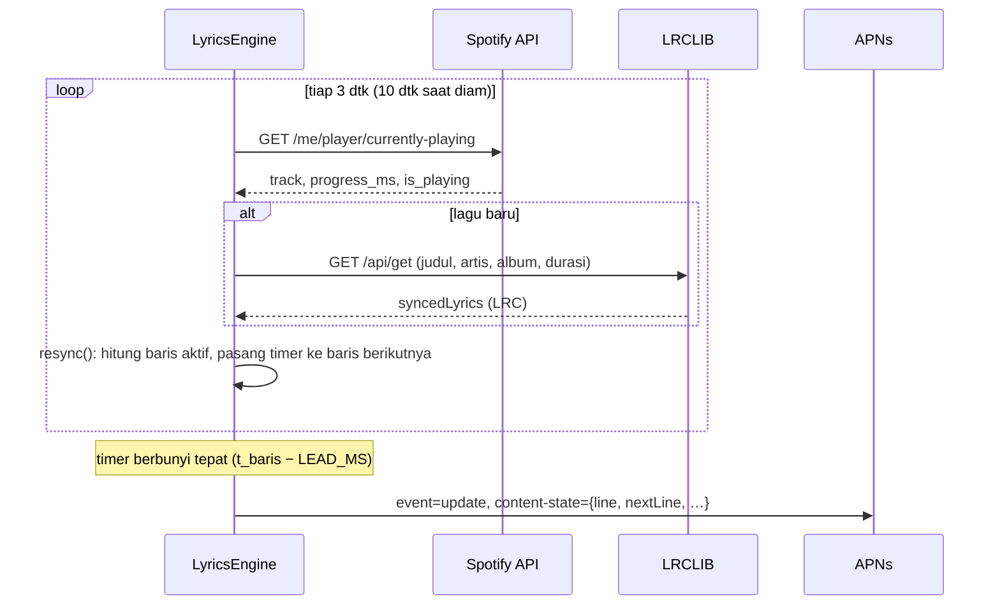
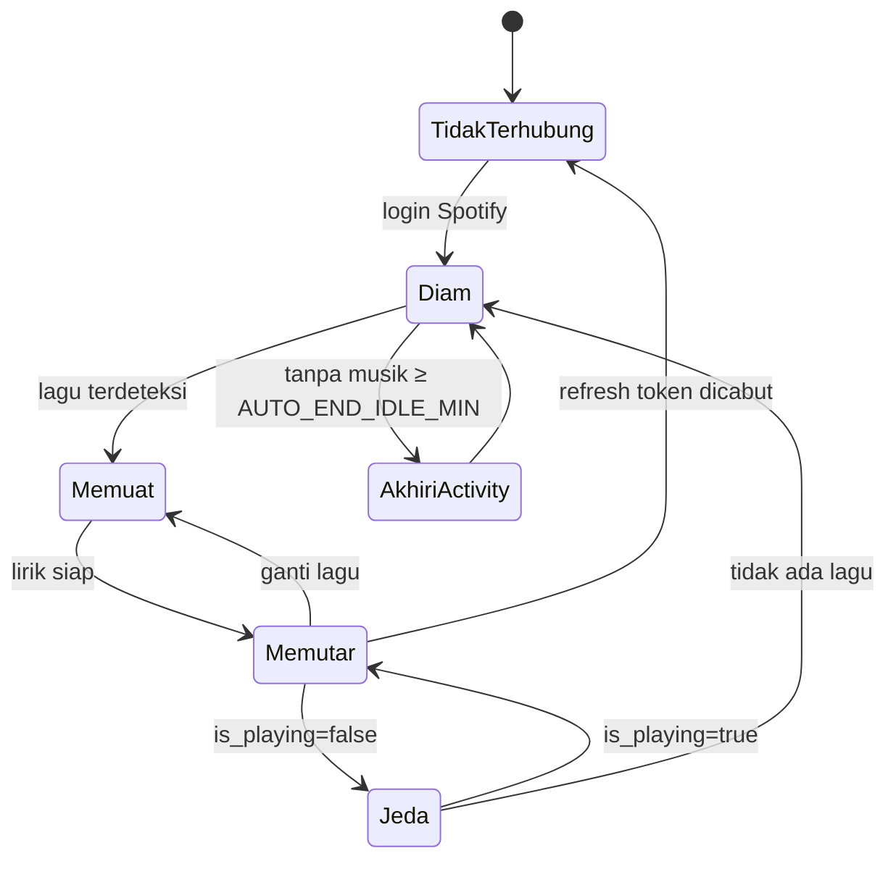
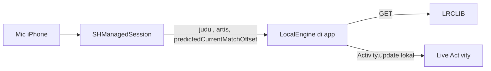

# DESIGN — Arsitektur Teknis Lirik Island

Dokumen ini menjelaskan **bagaimana** sistem bekerja. Untuk **apa** dan **kenapa**, lihat [PRD.md](PRD.md). Kontrak data persis ada di [API.md](API.md).

---

## 1. Gambaran besar



**Kenapa ada server?** iOS tidak menyediakan API publik untuk membaca lagu dari app lain, dan app kita tidak bisa terus hidup di background tanpa memutar/merekam audio. Server membaca posisi lagu dari Spotify Web API dan "mendorong" tiap baris lewat APNs. App iPhone hanya perlu dibuka untuk setup. Lihat [DECISIONS.md](DECISIONS.md) ADR-001.

## 2. Komponen

### 2.1 Server (`server/`)

Node.js ≥ 20.6, ES modules, **tanpa dependency runtime**. Semua modul menerima dependensi lewat parameter (fetch, clock, timers, log) supaya bisa dites tanpa jaringan.

| Modul | Tanggung jawab |
|---|---|
| `src/server.js` | Entry point: baca config, rakit semua modul, jalankan HTTP + engine, shutdown rapi |
| `src/config.js` | Baca & validasi env (`loadConfig(env)`) |
| `src/store.js` | State persisten di JSON (tulis atomik tmp→rename, mode 0600) |
| `src/spotify.js` | OAuth (authorize URL, tukar kode, refresh token), `getCurrentlyPlaying()` |
| `src/lyrics.js` | Parser LRC, `indexAt`, `cleanTitle`, `pickBest`, provider LRCLIB + cache |
| `src/apns.js` | JWT ES256, sesi HTTP/2 ke APNs, `send()`, mode dry-run |
| `src/engine.js` | **Inti**: polling, estimasi posisi, timer per baris, push update/start/end |
| `src/app.js` | HTTP API untuk app iPhone + alur login Spotify |
| `src/login-cli.js` | `npm run login` → minta link login sekali pakai ke server |
| `src/simulate.js` | `npm run simulate` → demo real-time tanpa Spotify/iPhone |

### 2.2 App iOS (`ios/LirikIsland/`)

SwiftUI, iOS 18+, Swift 5 language mode.

| File | Tanggung jawab |
|---|---|
| `LirikIslandApp.swift` | Entry + `AppDelegate` (mulai observasi token bahkan saat app dibangunkan di background) |
| `ActivityManager.swift` | `@MainActor` singleton: mulai/stop Live Activity, observasi `pushToStartTokenUpdates`, `activityUpdates`, `pushTokenUpdates`, `activityStateUpdates`, upload ke server |
| `ServerClient.swift` | Klien HTTP + model `ServerStatus` |
| `ContentView.swift` | Satu layar `Form`: pengaturan, status, tombol aksi |

### 2.3 Widget extension (`ios/LirikIslandWidget/`)

| File | Tanggung jawab |
|---|---|
| `LirikIslandWidgetBundle.swift` | `@main` bundle |
| `LyricsLiveActivity.swift` | `ActivityConfiguration` + semua tampilan (Dynamic Island, Lock Screen `.medium`, CarPlay `.small`) + preview |

### 2.4 Kode bersama (`ios/Shared/`)

`LyricsActivityAttributes.swift` — tipe `ActivityAttributes` yang dipakai app **dan** widget. Harus identik dengan kontrak di `contract/live-activity.json`.

## 3. Alur utama

### 3.1 Setup pertama



### 3.2 Siklus per baris lirik



### 3.3 Auto-start (push-to-start)

Bila musik diputar, tidak ada Live Activity terdaftar, dan server punya push-to-start token → kirim `event: start` (cooldown 60 dtk). iOS membuat Live Activity, membangunkan app di background, app mengirim token update baru ke `/api/activity-token`, lalu engine langsung mengirim baris aktif.

Catatan: iOS tidak selalu mengirim token update setelah push-to-start bila app sudah lama mati (lihat PRD §10 #3).

## 4. Algoritma sinkronisasi (engine)

### 4.1 Estimasi posisi

Setiap polling menyimpan *anchor*:

```
anchor = { progressMs: progress_ms + latensi/2, at: waktu_terima }
posisi(t) = playing ? anchor.progressMs + (t − anchor.at) : anchor.progressMs
            (dijepit ke [0, durasi])
```

`latensi/2` = setengah waktu bolak-balik request Spotify — kira-kira kapan Spotify mengukur posisi.

### 4.2 Pemilihan baris & timer

```
pos   = posisi(now) + (playing ? LEAD_MS : 0)
idx   = indexAt(lines, pos)          // binary search: baris terakhir dengan t ≤ pos
kirim jika state berubah
timer = lines[idx+1].t − pos         // minimal 30 ms
```

Setiap polling memanggil `resync()` ulang, sehingga seek/pause/drift terkoreksi otomatis paling lambat satu siklus polling. Menjelang lagu habis, polling berikutnya dimajukan ke `sisa + 600 ms` agar lagu baru cepat terdeteksi.

### 4.3 State yang dikirim

`buildState()` menghasilkan objek kontrak (`title, artist, line, nextLine, isPlaying, hasLyrics`). Aturan isi `line`:

| Kondisi | `line` | `nextLine` |
|---|---|---|
| Tidak ada lagu | "Putar lagu di Spotify" | "" |
| Lirik dimuat | "Memuat lirik…" | "" |
| Tersinkron, sebelum baris pertama / baris kosong | "♪" | baris non-kosong berikutnya |
| Tersinkron | teks baris aktif | baris non-kosong berikutnya |
| Instrumental | "♪ Instrumental ♪" | "" |
| Hanya lirik biasa | "Lirik ada, tapi belum tersinkron" | "" |
| Tidak ada | "Lirik tidak ditemukan" | "" |
| Gagal | "Gagal memuat lirik" | "" |

Teks dipotong 140 karakter (NFR-3).

### 4.4 Pembatasan push

- **Dedupe**: state di-`JSON.stringify` dan dibandingkan dengan yang terakhir terkirim.
- **Jeda minimum** `MIN_PUSH_INTERVAL_MS` (1000): bila terlalu cepat, satu timer tunda; saat berbunyi state dibangun ulang (selalu yang terbaru).
- **Timestamp APNs naik terus**: `ts = max(floor(now/1000), ts_terakhir + 1)` — APNs mengabaikan update dengan timestamp ≤ sebelumnya.
- **stale-date** = ts + 900 dtk, sehingga UI meredup bila server mati.

### 4.5 State machine engine



## 5. Penanganan error

| Sumber | Kondisi | Tindakan |
|---|---|---|
| Spotify | 401 | Refresh access token, ulangi sekali |
| Spotify | 400 `invalid_grant` saat refresh | Hapus refresh token → status "belum terhubung" |
| Spotify | 429 | Polling berikutnya ditunda `Retry-After` |
| Spotify | 204 / iklan / podcast | Diperlakukan sebagai jeda |
| LRCLIB | 404 | Coba `/api/search` |
| LRCLIB | 5xx / jaringan | Status `error`, **tidak di-cache** (dicoba lagi saat lagu diputar ulang) |
| APNs | 410, 400 `BadDeviceToken` | Hapus token activity / push-to-start |
| APNs | error lain | Tandai belum terkirim → dicoba lagi saat resync berikutnya |
| APNs | koneksi HTTP/2 putus / GOAWAY | Sesi dibuat ulang pada push berikutnya |
| Live Activity | > 8 jam | Dianggap mati, auto-start bila musik masih jalan |

## 6. Persistensi

`DATA_DIR/state.json`:

```json
{
  "refreshToken": "…",
  "pushToStartToken": "hex…",
  "activity": { "token": "hex…", "id": "UUID", "registeredAtMs": 1793075625470 }
}
```

Cache lirik hanya di memori (hilang saat restart — disengaja, data mudah diambil ulang).

## 7. Keamanan

- Semua `/api/*` memerlukan header `x-api-key`, dibandingkan dengan `timingSafeEqual` atas hash SHA-256.
- Login Spotify memakai link **sekali pakai** (nonce 10 menit) + parameter `state` OAuth sekali pakai → tidak bisa dipakai orang lain untuk menautkan akun Spotify mereka ke server Anda.
- Token push divalidasi hex 32–512 karakter. Body JSON dibatasi 16 KB.
- `state.json` ditulis dengan mode 0600; `.env` dan `*.p8` di-`.gitignore`.
- Di iOS, API key saat ini di UserDefaults → **dipindah ke Keychain di Fase 1 (FR-41)**.

## 8. Deployment

| Lingkungan | Cara | Catatan |
|---|---|---|
| Lokal | `npm run dev` (pakai `.env`) | `PUBLIC_URL=http://127.0.0.1:8888`; login Spotify dari komputer yang sama |
| Coolify | Dockerfile di **root monorepo**, port 8888, domain HTTPS | Env dari dashboard (`APNS_KEY_BASE64`), **persistent storage `/data`**. Base Directory `/` (bukan `server/`). Opsional: `docker-compose.yml` di root. |

`APNS_ENV=development` untuk build dari Xcode, `production` untuk TestFlight/App Store. Token dari dua lingkungan tidak tertukar.

## 9. Desain Fase 2 — mode ShazamKit (rencana)

Tujuan: sumber lagu alternatif tanpa Spotify API, untuk semua pemutar.



- **Tanpa server & APNs**: app tetap hidup di background karena merekam audio (`UIBackgroundModes: audio`), sehingga Live Activity di-update lokal.
- **Port engine ke Swift**: `parseLrc`, `indexAt`, pemilihan baris, dan timer ditulis ulang di Swift dengan logika yang sama (tes dengan data yang sama — lihat TESTING.md).
- **Re-match** tiap 10–20 dtk untuk koreksi drift, deteksi ganti lagu; tidak ada match selama N dtk → anggap jeda.
- **AVAudioSession**: `.playAndRecord` + `.mixWithOthers` + `.allowBluetoothA2DP`, input dipaksa ke mic internal. **Spike wajib**: pastikan audio CarPlay tidak pindah ke mode telepon (PRD §10 #4).
- Pilihan sumber di app: "Spotify (server)" atau "Dengar lewat mic".

## 10. Batasan platform yang memengaruhi desain

- Payload Live Activity maks. 4 KB.
- Live Activity aktif maks. 8 jam.
- Push Live Activity prioritas 10 memakai jatah sistem; `NSSupportsLiveActivitiesFrequentUpdates` menambah jatah, tapi pengguna bisa mematikannya.
- CarPlay memakai family `.small` (iOS 26); tanpa itu jatuh ke tampilan compact Dynamic Island. Live Activity di CarPlay tidak interaktif.
- Spotify Development Mode: Premium wajib, maks. 5 user, refresh token 6 bulan.
